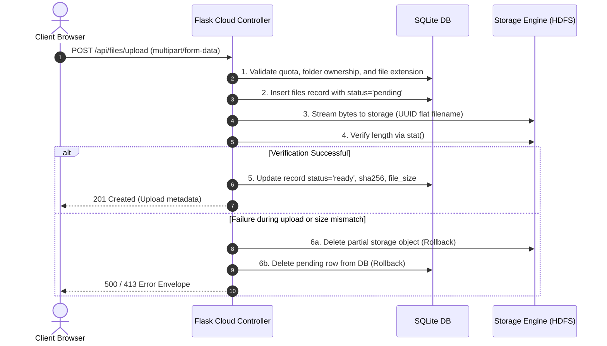
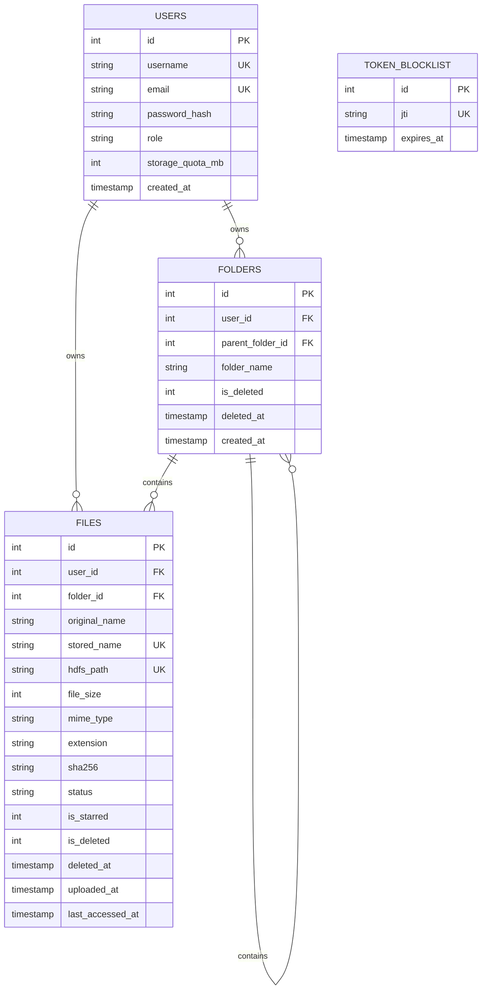

# MiniCloud — Private Cloud Storage SaaS with Custom HDFS Cloud Controller

> **Academic Mini-Project Submission:**  
> *"Set up your own Cloud for Software as a Service (SaaS) over the existing LAN in your laboratory. Write your own code for Cloud Controller using Open Source Technologies to implement it with HDFS."*

---

## 1. Title
**MiniCloud: An On-Premise Software as a Service (SaaS) Cloud Storage Solution with Custom WebHDFS Controller Orchestration over Laboratory Local Area Networks.**

---

## 2. Abstract
MiniCloud is a private, lightweight Cloud Storage SaaS (Software as a Service) platform engineered to deliver Google Drive-style file synchronization and storage capabilities across an institutional laboratory Local Area Network (LAN). The core of the system is a custom **Cloud Controller** built in Python and Flask that mediates all storage operations, enforces per-user quotas, maintains virtual folder hierarchies, and orchestrates block transfers with an Apache Hadoop Distributed File System (HDFS) cluster using the WebHDFS REST protocol. The presentation layer is an offline-ready Single Page Application (SPA) built using React 18, Vite 5, and Tailwind CSS 3.4 featuring a glassmorphism user interface with light and dark theme support. MiniCloud eliminates client-side HDFS dependencies, protects against path-traversal attacks through UUID flat storage abstraction, and supports single-port LAN deployment on Windows via Waitress.

---

## 3. Problem Statement
Academic laboratories frequently require secure, centralized, and high-capacity storage for student assignments, dataset distribution, and collaborative project artifacts. Public cloud storage platforms (Google Drive, Dropbox, AWS S3) suffer from external internet bandwidth bottlenecks, recurring subscription costs, and institutional data privacy concerns. Native Apache Hadoop installations are designed for batch analytics and lack consumer-grade SaaS user interfaces, multi-tenant file management abstractions, user quota mechanisms, and cross-platform browser accessibility over a local network.

---

## 4. Objectives
1. Implement a complete Software as a Service (SaaS) cloud storage platform over an existing laboratory LAN.
2. Develop a custom **Cloud Controller** using open-source technologies (Python/Flask) that interfaces with Apache Hadoop HDFS via WebHDFS.
3. Create an abstract storage interface supporting both production HDFS clusters and offline local development mock storage.
4. Decouple virtual user folder hierarchies in SQLite from physical block storage on HDFS using flat UUID naming conventions.
5. Implement an atomic 6-step upload consistency protocol with automatic rollbacks upon failure.
6. Provide single-port LAN access (`http://<HOST_IP>:5000`) enabling any lab computer or mobile device to access the SaaS via a browser.
7. Integrate administrative telemetry pulling live DataNode status, block counts, and storage pool metrics from NameNode JMX endpoints.

---

## 5. Scope
- **Target Environment**: Laboratory Local Area Networks (LAN) connected via Ethernet switches or Wi-Fi routers.
- **Client Requirements**: Modern web browser (Chrome, Edge, Firefox, Safari) on any OS (Windows, Linux, macOS, Android, iOS) without any client software or Hadoop plugins installed.
- **Storage Backend**: Single-node pseudo-distributed or multi-node Apache Hadoop 3.3.6 HDFS cluster (running in Ubuntu VM, WSL2, or Docker), with built-in mock filesystem fallback for offline testing.

---

## 6. Technologies
| Tier | Technology | Version | Purpose |
|---|---|---|---|
| Cloud Controller | Python | 3.11 / 3.14 | Core orchestration runtime |
| Web Framework | Flask | 3.0.3 | REST API controller |
| WSGI Server | Waitress | 3.0.0 | Windows production server |
| Authentication | Flask-JWT-Extended | 4.6.0 | JWT tokens with database blocklist |
| Database | SQLite | 3.x | WAL mode metadata storage |
| Storage Engine | Apache Hadoop HDFS | 3.3.6 | Distributed raw block storage |
| Storage Interface | WebHDFS REST API | RFC-compliant | Streaming upload/download protocol |
| Frontend Framework | React | 18.2.0 | Reactive Single Page Application |
| Build Tool | Vite | 5.2.0 | Frontend build tooling |
| CSS Framework | Tailwind CSS | 3.4.3 | Glassmorphism design system |
| Charts & UI | Recharts / Lucide React | 2.12 / 0.363 | Donut chart and icons |

---

## 7. System Requirements
- **Host Machine (Controller)**:
  - OS: Windows 10/11 (or Linux/macOS)
  - RAM: 8 GB minimum (16 GB recommended if running Hadoop VM concurrently)
  - Software: Python 3.10+, Node.js 18+, Git
- **Hadoop Node (Storage Cluster)**:
  - OS: Ubuntu 22.04 LTS (VirtualBox/VMware VM with Bridged IP or Docker Desktop)
  - Java: OpenJDK 11
  - Hadoop: Apache Hadoop 3.3.6
- **Client Computers**:
  - Any desktop or mobile web browser connected to the lab LAN subnet.

---

## 8. Architecture

```mermaid
graph TD
    ClientBrowser["Client Web Browser (LAN)"] -->|HTTP / React SPA (:5000)| FlaskController["Flask Cloud Controller (:5000)"]

    subgraph "Host PC (Cloud Controller)"
        FlaskController -->|Auth, Quotas, Folders| SQLiteDB[("SQLite Metadata DB (WAL Mode)")]
        FlaskController -->|StorageBackend Interface| StorageRouter{"Storage Backend Factory"}
        StorageRouter -->|Real Mode| HdfsStorage["HdfsStorage (WebHDFS REST)"]
        StorageRouter -->|Dev/Mock Mode| MockStorage["MockStorage (Local Filesystem)"]
    end

    subgraph "Hadoop Cluster (Ubuntu VM / Docker)"
        HdfsStorage -->|Step 1: PUT CREATE| NameNode["HDFS NameNode (:9870)"]
        NameNode -->|Step 2: 307 Redirect Location| HdfsStorage
        HdfsStorage -->|Step 3: Direct Stream PUT| DataNode1["HDFS DataNode 1 (:9864)"]
        DataNode1 -.->|Block Replication factor=2| DataNode2["HDFS DataNode 2 (:9864)"]
        HdfsStorage -.->|Telemetry: /jmx?qry=...| NameNode
    end
```

---

## 9. Data Flow: 6-Step Upload Consistency Protocol



---

## 10. Database Schema (SQLite with WAL & Foreign Keys)



### Why Folders are Virtual:
Folders exist solely as records in the `folders` SQLite table. File paths in HDFS are flat: `/minicloud/users/{user_id}/files/{uuid4}{extension}`. This ensures:
- Renaming or moving folders requires updating only a single SQLite row (0 milliseconds) without touching HDFS block storage.
- User-supplied filenames never become directory paths, completely eliminating directory traversal vulnerabilities.

---

## 11. API Endpoints Summary

| Method | Endpoint | Description |
|---|---|---|
| `POST` | `/api/auth/register` | Register user (first user becomes `admin`) |
| `POST` | `/api/auth/login` | Authenticate and obtain JWT token |
| `POST` | `/api/auth/logout` | Invalidate JWT token via `token_blocklist` |
| `GET` | `/api/auth/me` | Fetch user profile and storage quota |
| `POST` | `/api/auth/change-password` | Update account password |
| `GET` | `/api/dashboard/stats` | File counts, storage quota bar, and donut breakdown |
| `GET` | `/api/dashboard/recent-files` | Up to 10 recently accessed/uploaded files |
| `GET` | `/api/files` | List files (query: `folder_id`, `view`, `q`, `sort`, `page`) |
| `POST` | `/api/files/upload` | Multipart upload with 6-step consistency protocol |
| `GET` | `/api/files/<id>/download` | Stream file content with RFC 5987 disposition |
| `POST` | `/api/files/<id>/download-token`| Generate 60s signed single-use download token |
| `PATCH` | `/api/files/<id>` | Rename or move file to another folder |
| `POST/DELETE` | `/api/files/<id>/star` | Toggle starred status |
| `DELETE` | `/api/files/<id>` | Soft-delete file to Trash |
| `POST` | `/api/files/<id>/restore` | Restore file from Trash |
| `DELETE` | `/api/files/<id>/permanent` | Delete from HDFS first, then remove DB record |
| `DELETE` | `/api/trash` | Permanently empty entire Trash |
| `GET` | `/api/folders` | List subfolders in directory |
| `POST` | `/api/folders` | Create virtual folder (duplicate check per parent) |
| `GET` | `/api/folders/<id>/contents` | Get folder breadcrumbs, subfolders, and files |
| `PATCH` | `/api/folders/<id>` | Rename folder |
| `DELETE` | `/api/folders/<id>` | Move folder and its contents to Trash |
| `GET` | `/api/storage/usage` | Configured quota vs HDFS cluster capacity |
| `GET` | `/api/health` | App status, DB connectivity, and storage mode |
| `GET` | `/api/health/hdfs` | Dedicated HDFS status (503 if down) |
| `GET` | `/api/admin/cluster` | (Admin only) NameNode JMX DataNodes & blocks |

---

## 12. Installation Instructions

### Clone / Navigate to Project Directory:
```powershell
cd "e:\New folder\Cloud Project"
```

### Install Backend Dependencies:
```powershell
python -m pip install -r .\backend\requirements.txt
```

### Install Frontend Dependencies:
```powershell
cd frontend
npm install
cd ..
```

---

## 13. Hadoop/HDFS Setup (Option A - Ubuntu VM)
Refer to [hadoop-config/setup-notes.md](file:///e:/New%20folder/Cloud%20Project/hadoop-config/setup-notes.md) for full commands:
1. Boot Ubuntu 22.04 LTS VM with Bridged Networking.
2. Install OpenJDK 11 and unpack Hadoop 3.3.6 to `/usr/local/hadoop`.
3. Copy `hadoop-config/core-site.xml` and `hdfs-site.xml` into `/usr/local/hadoop/etc/hadoop/`.
4. Format NameNode: `hdfs namenode -format`.
5. Start daemons: `start-dfs.sh`.
6. Create MiniCloud base path: `hdfs dfs -mkdir -p /minicloud && hdfs dfs -chmod 777 /minicloud`.

---

## 14. Backend Setup
1. Copy configuration template:
   ```powershell
   cp .\backend\.env.example .\backend\.env
   ```
2. For local testing without Hadoop: keep `STORAGE_BACKEND=mock`.
3. For real Hadoop in lab: set `STORAGE_BACKEND=hdfs`, `HDFS_NAMENODE_HOST=<VM_IP>`, and `HDFS_USER=hadoop`.
4. Create initial administrator user:
   ```powershell
   python .\scripts\create_admin.py --username admin --email admin@minicloud.lan --password AdminPassword123
   ```

---

## 15. Frontend Setup
Compile production distribution:
```powershell
cd frontend
npm run build
cd ..
```

---

## 16. Configuration Variables (`backend/.env`)
```ini
FLASK_SECRET_KEY=secure-random-key
JWT_SECRET_KEY=secure-jwt-key
JWT_ACCESS_TOKEN_MINUTES=60
APP_HOST=0.0.0.0
APP_PORT=5000
DATABASE_PATH=./minicloud.db

STORAGE_BACKEND=mock          # 'hdfs' for real Hadoop, 'mock' for local dev
HDFS_NAMENODE_HOST=127.0.0.1
HDFS_WEBHDFS_PORT=9870
HDFS_BASE_PATH=/minicloud
HDFS_USER=hadoop
HDFS_REPLICATION_FACTOR=1

MAX_UPLOAD_SIZE_MB=100
USER_STORAGE_QUOTA_MB=1024
BLOCKED_EXTENSIONS=.exe,.bat,.cmd,.sh,.js,.msi
```

---

## 17. Running MiniCloud

### Mode 1: LAN Production Server (Recommended for Demos)
Runs Waitress serving both backend API and React SPA on port 5000:
```powershell
powershell -ExecutionPolicy Bypass -File .\scripts\run-lan-server.ps1
```

### Mode 2: Concurrent Development Mode (Vite + Flask)
Runs Flask on port 5000 with Vite HMR on port 5173:
```powershell
powershell -ExecutionPolicy Bypass -File .\scripts\start-dev.ps1
```

---

## 18. LAN Demonstration Steps
1. Open PowerShell and find your local IP: `ipconfig` (e.g. `192.168.1.100`).
2. Run firewall rule (Admin once):
   ```powershell
   New-NetFirewallRule -DisplayName "MiniCloud Cloud Controller (Port 5000)" -Direction Inbound -LocalPort 5000 -Protocol TCP -Action Allow
   ```
3. Start server via `.\scripts\run-lan-server.ps1`.
4. Open `http://<HOST_IP>:5000` from any other lab PC or mobile device on the same LAN.

---

## 19. Troubleshooting Table

| Issue / Error | Root Cause | Solution |
|---|---|---|
| `Connection refused on port 9870` | Hadoop NameNode daemon is not running | Run `start-dfs.sh` in Hadoop VM; verify with `jps` |
| `NameNode in safe mode` | HDFS NameNode is safely verifying blocks on startup | Run `hdfs dfsadmin -safemode leave` |
| `DataNode redirect fails (WinError 10061)` | Hostname returned by 307 redirect cannot be resolved by Windows | Add VM IP and hostname to `C:\Windows\System32\drivers\etc\hosts` and set `dfs.client.use.datanode.hostname=true` |
| `Permission denied for HDFS_USER` | Directory `/minicloud` owned by different user | Run `hdfs dfs -chmod -R 777 /minicloud` |
| `Windows Firewall blocks LAN access` | Port 5000 blocked on Windows host | Run `New-NetFirewallRule` PowerShell command listed in Section 18 |
| `Database is locked (SQLite)` | Concurrent writes in standard journal mode | WAL mode is activated automatically (`PRAGMA journal_mode=WAL;`) |
| `CORS Error on port 5173` | Vite accessing Flask on different port | Check `CORS_ORIGINS` in `.env` or run single-port Waitress mode |

---

## 20. Testing (Separated Mock vs Real HDFS)

### Automated Test Suite (Pytest on MockStorage):
Run all 12 automated unit tests:
```powershell
python -m pytest .\backend\tests\ -v
```
Covers:
- `test_health_check`, `test_first_user_becomes_admin`, `test_second_user_becomes_regular_user`, `test_duplicate_registration_rejected`, `test_login_and_me_endpoint`, `test_logout_revokes_token`.
- `test_file_upload_and_download`, `test_download_token_workflow`, `test_blocked_extension_rejection`, `test_user_ownership_isolation`, `test_virtual_folder_crud`, `test_trash_restore_and_permanent_delete`.

### Real HDFS Standalone Smoke Test:
```powershell
python .\scripts\hdfs_smoke_test.py --backend hdfs --namenode <HADOOP_IP> --port 9870 --user hadoop
```

---

## 21. Limitations and Honest Scope
1. **Single Controller**: The Flask controller is a single instance; high-availability controller clustering with load balancers is outside scope.
2. **Metadata Scale**: SQLite is utilized for simplicity in college viva demonstrations; a multi-million-file enterprise deployment would migrate to PostgreSQL.
3. **No In-Transit Encryption by Default**: Demo runs over HTTP on a private lab subnet; HTTPS would require institutional TLS certificates.
4. **No File Versioning or Public Sharing**: MiniCloud focuses exclusively on private user storage, quotas, and HDFS orchestration.

---

## 22. Future Enhancements
- Integration of Apache Ranger / Kerberos for enterprise HDFS token delegation.
- File preview modal for PDFs, images, and audio directly in the browser.
- Time-limited shared links between users.
- Automatic chunked deduplication via cryptographic content hashing.

---

## 23. Conclusion
MiniCloud successfully fulfills the academic assignment by deploying an operational Cloud Storage SaaS across a laboratory LAN. By implementing a custom Cloud Controller in Python/Flask that communicates with Apache Hadoop HDFS via WebHDFS REST operations, it decouples complex distributed storage administration from everyday student file management. Its glassmorphism interface, atomic consistency protocol, and multi-node replication support provide an authentic, demonstrable private cloud storage platform.
