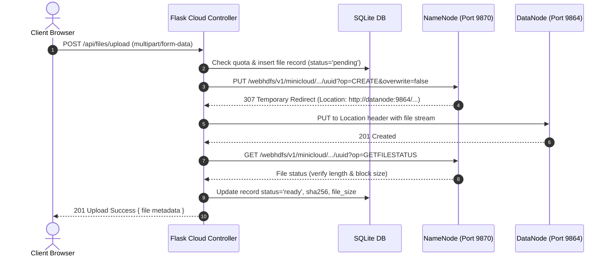
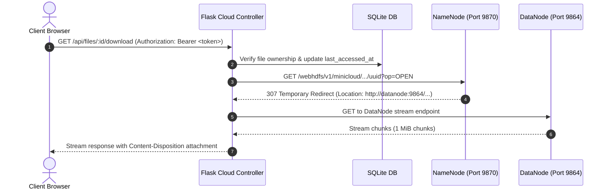

# MiniCloud - Architecture & System Design Specification

## 1. System Overview
**MiniCloud** is an on-premise Software as a Service (SaaS) private cloud storage application built on top of Apache Hadoop HDFS. It acts as a lightweight Google Drive alternative designed to run across an institutional local area network (LAN).

```mermaid
graph TD
    UserBrowser["Lab Client Browsers (LAN)"] -->|HTTP / React SPA :5000| FlaskApp["Flask Cloud Controller (:5000)"]
    
    subgraph "Host Machine (Cloud Controller)"
        FlaskApp -->|Auth & Metadata CRUD| SQLite[("SQLite Metadata DB (WAL Mode)")]
        FlaskApp -->|StorageBackend Interface| StorageRouter{"Storage Backend Dispatcher"}
        StorageRouter -->|Real Mode| HDFSAdapter["HdfsStorage (WebHDFS REST)"]
        StorageRouter -->|Dev/Mock Mode| MockAdapter["MockStorage (Local FS)"]
    end

    subgraph "Hadoop HDFS Cluster (VM / WSL2 / Docker)"
        HDFSAdapter -->|Step 1: PUT CREATE (op=CREATE)| NameNode["HDFS NameNode (:9870)"]
        NameNode -->|Step 2: 307 Redirect (Location Header)| HDFSAdapter
        HDFSAdapter -->|Step 3: Direct Data Stream PUT| DataNode1["HDFS DataNode 1 (:9864)"]
        HDFSAdapter -.->|Optional 2nd Replica| DataNode2["HDFS DataNode 2 (:9864)"]
        DataNode1 -.->|Block Replication factor=2| DataNode2
    end
```

---

## 2. Component Layering

1. **Presentation Layer (Frontend)**:
   - React 18 SPA built with Vite 5 and Tailwind CSS 3.4.
   - Glassmorphism design system with responsive sidebar, My Files explorer, dynamic stats, Recharts donut breakdown, and real-time upload progress.
   - Interacts with Cloud Controller via REST API using Bearer JWT tokens.

2. **Control & Orchestration Layer (Cloud Controller - Flask)**:
   - **Routes**: Enforces authentication (`Flask-JWT-Extended`), request validation, standard response envelopes (`{success, data}` or `{success, error}`).
   - **Services**: Enforces business logic: user storage quotas, virtual directory hierarchical consistency, UUID flat naming, and atomic failure-cleanup protocols.
   - **Data Access & Metadata**: SQLite with foreign keys enabled, WAL journal mode, maintaining virtual folders and physical file mappings.
   - **Storage Abstraction**: `StorageBackend` base class providing unified operations (`upload`, `download`, `delete`, `stat`, `exists`, `health`, `cluster_info`).

3. **Storage Engine (HDFS & WebHDFS)**:
   - Flat file layout on HDFS: `/minicloud/users/{user_id}/files/{uuid4}{extension}`.
   - Elimination of path traversal attacks and zero-cost directory renames/moves.
   - WebHDFS REST API handles all block data transfers via two-step HTTP PUT and streaming HTTP GET.

---

## 3. Upload & Download Data Flow

### Upload Flow (Two-Step WebHDFS Handshake)


### Download Flow

