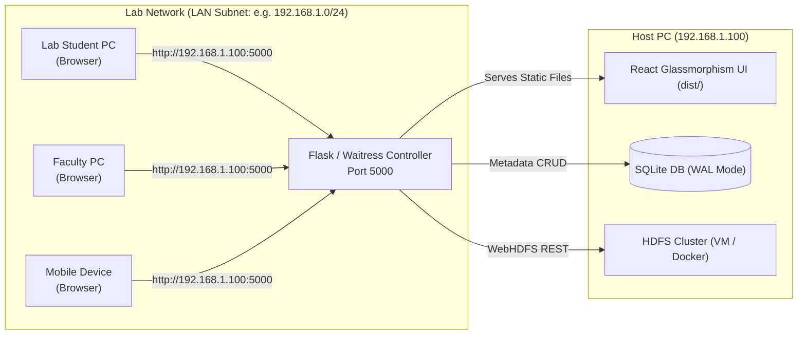

# MiniCloud LAN Demonstration & Multi-Node Cluster Guide

This document provides exact steps to demonstrate MiniCloud across computers on your laboratory Local Area Network (LAN) and upgrade your Hadoop HDFS installation from a single node to a multi-node replicated cluster.

---

## 1. LAN Architecture: Why Single-Port (Port 5000)?



### Key Advantages for College Demonstrations:
1. **Single Firewall Port**: You only open port `5000` on Windows Firewall.
2. **Zero CORS Issues**: The frontend is served directly from the same origin as the API.
3. **No HDFS Exposure**: Student browsers never directly access HDFS or DataNode ports; the Cloud Controller mediates all operations securely.

---

## 2. Windows Host Setup & Demonstration Steps

### Step 1: Find your Host LAN IP
Open Windows PowerShell:
```powershell
ipconfig
```
Look for `IPv4 Address` under your active Wi-Fi or Ethernet adapter (e.g. `192.168.1.100`).

### Step 2: Open Windows Firewall for Port 5000
Run PowerShell as **Administrator**:
```powershell
New-NetFirewallRule -DisplayName "MiniCloud Cloud Controller (Port 5000)" -Direction Inbound -LocalPort 5000 -Protocol TCP -Action Allow
```

### Step 3: Run the LAN Production Server (Waitress)
Run:
```powershell
powershell -ExecutionPolicy Bypass -File .\scripts\run-lan-server.ps1
```
Or directly via Python:
```powershell
cd backend
python -m waitress --host=0.0.0.0 --port=5000 app:app
```

### Step 4: Test from a Second Lab Computer or Phone
1. Connect the second computer or phone to the same lab Wi-Fi or LAN switch.
2. Open Chrome/Edge/Firefox on the second device.
3. Navigate to:
   ```text
   http://192.168.1.100:5000
   ```
4. Register a new user account. Upload, download, and organize files.

---

## 3. Resolving the WebHDFS DataNode 307 Redirect Problem

### The Problem:
When you perform an upload or download through WebHDFS:
1. The Cloud Controller requests the NameNode (`PUT /webhdfs/v1/.../?op=CREATE`).
2. The NameNode replies `307 Temporary Redirect` with the `Location` header pointing to the DataNode:
   `http://datanode1:9864/...`
3. If your Windows host does not know what `datanode1` means, the connection fails with:
   `Failed to establish a new connection: [WinError 10061]` or `Name or service not known`.

### The Solution:
1. **In Hadoop (`hdfs-site.xml`)**:
   Ensure both properties are set:
   ```xml
   <property>
       <name>dfs.client.use.datanode.hostname</name>
       <value>true</value>
   </property>
   <property>
       <name>dfs.datanode.use.datanode.hostname</name>
       <value>true</value>
   </property>
   ```

2. **In Windows Hosts File** (`C:\Windows\System32\drivers\etc\hosts`):
   Map the Hadoop VM's IP address to the hostname:
   ```text
   192.168.1.105   namenode datanode1 datanode2
   ```

---

## 4. Upgrading to a Multi-Node Cluster (Replication Factor = 2 or 3)

MiniCloud is architected to transition from single-node to multi-node with **zero code modifications**.

### Step 1: Attach Second DataNode
In `hadoop-config/docker-compose.yml`, a second DataNode container `minicloud-datanode2` is already preconfigured on port 9865.

If using real VMs:
1. Clone your Ubuntu DataNode VM (`datanode2`).
2. In the NameNode VM, edit `/usr/local/hadoop/etc/hadoop/workers`:
   ```text
   datanode1
   datanode2
   ```

### Step 2: Update Replication Factor
Edit `hdfs-site.xml`:
```xml
<property>
    <name>dfs.replication</name>
    <value>2</value>
</property>
```
And in `backend/.env`:
```ini
HDFS_REPLICATION_FACTOR=2
```

### Step 3: Verify Multi-Node Replication in Terminal
Upload a file through MiniCloud, then on your Hadoop terminal run:
```bash
hdfs fsck /minicloud -files -blocks -locations
```

**Expected FSCK Output Proving Multi-Node Block Distribution:**
```text
Connecting to namenode via default filesystem
FSCK started by hadoop (auth:SIMPLE) from /127.0.0.1 for path /minicloud at Sun Oct 11 2026
/minicloud/users/1/files/4a3c1e2f.pdf 12582912 bytes, 1 block(s):  OK
0. BP-18273645-127.0.0.1-169827364:blk_1073741825_1001 len=12582912 Live_repl=2 [DatanodeInfoWithStorage[192.168.1.105:9864,...], DatanodeInfoWithStorage[192.168.1.106:9864,...]]

Status: HEALTHY
 Number of data-nodes:                     2
 Number of racks:                          1
 Total size:                               12582912 B
 Total blocks (validated):                 1 (avg. block size 12582912 B)
 Minimally replicated blocks:              1 (100.0 %)
 Over-replicated blocks:                   0 (0.0 %)
 Under-replicated blocks:                  0 (0.0 %)
 Mis-replicated blocks:                    0 (0.0 %)
 Default replication factor:               2
 Average block replication:                2.0
 Corrupt blocks:                           0
 Missing replicas:                         0 (0.0 %)
 Number of data-nodes:                     2
 Number of racks:                          1
FSCK ended at Sun Oct 11 2026.
The filesystem under path '/minicloud' is HEALTHY
```

And check your MiniCloud UI under **Cluster Status (Admin)**:
- Live DataNodes: **2**
- Configured Replication Factor: **2**
